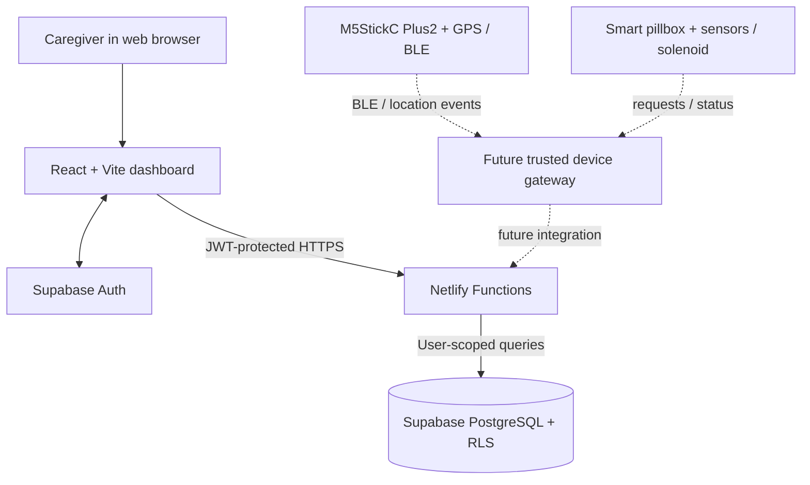

# GeoWrisX AD
### Dual-Safety Assistive Technology · Student R&D Prototype

**GeoWrisX AD** is a student innovation project exploring how a caregiver web console can support two safety workflows for people living with Alzheimer's disease: awareness of wandering-related events and controlled medication access.

โครงงานต้นแบบเพื่อศึกษาแนวทางผสานระบบแจ้งเตือนพื้นที่ปลอดภัยกับขั้นตอนอนุมัติการเข้าถึงกล่องยา โดยให้ผู้ดูแลเป็นส่วนหนึ่งของกระบวนการตัดสินใจ

> **Project status:** Research and development prototype. The web dashboard has been deployed and the Supabase dashboard data flow was tested during development. The physical wristband, GPS/geofencing, BLE proximity verification, MQTT/device gateway and solenoid actuation are **not yet validated as a complete real-world system**. This project is not a certified medical device or emergency service.

**Documentation:** [SDLC step-by-step guide (Thai)](SDLC.md) · [Portfolio brief](PORTFOLIO.md) · [Technical setup and API reference](geowrisx-web/README.md) · [Supabase schema](geowrisx-web/supabase/setup.sql)

---

## The problem

Caregivers may need to respond to two different types of situations:

1. **Wandering-related events:** a person leaves a defined safe area or a wearable appears to have been removed.
2. **Medication-access requests:** the system should not treat a web-button click alone as proof that a pillbox is safe to unlock. A future integrated flow is designed around device-side BLE proximity evidence plus caregiver approval.

GeoWrisX AD explores a **Dual-Safety Matrix**: wearable/event awareness + caregiver-controlled medication access. It is intended to support caregivers, not replace clinical advice or human supervision.

## What is implemented in this repository?

| Area | Current implementation |
|---|---|
| Caregiver interface | Responsive React dashboard and sign-in/sign-up screens |
| Patient management | Create/edit patient profiles; optional relationship/date fields; archive/restore without deleting related history |
| Caregiver profile | Update display name, phone and relationship; account email is read-only in this screen |
| Authentication | Supabase Auth; password handling and JWT sessions are managed by Supabase Auth |
| Data storage | PostgreSQL schema for patient profiles, caregiver profiles, devices, alerts, approvals and queued commands |
| Access control | Row Level Security (RLS) policies and explicit table grants defined in the SQL setup |
| Server-side API | Netlify Functions for dashboard queries, patient create/update/archive, caregiver profile read/update, pillbox approval and prototype device-event ingestion |
| Deployment | GitHub repository connected to Netlify; build configuration is in `geowrisx-web/netlify.toml` |
| Physical hardware | **Integration work remains.** Do not claim real-device operation until the BLE/GPS/firmware/gateway path is implemented and tested end to end. |

The database setup script defines an `approve_pillbox_request(uuid)` routine. Before demonstrating pillbox approval, verify that this routine exists in the live Supabase database and test the full expiry/ownership/BLE checks. A queued command is not the same as a physical lock being actuated.

## Architecture



**Important:** The device gateway and the hardware links in the diagram are planned integration points, not claims of a completed hardware implementation.

## Technology stack

- **Frontend:** React, Vite, Tailwind CSS v4, Lucide
- **Authentication:** Supabase Auth
- **Database and access rules:** Supabase PostgreSQL, RLS
- **Backend:** Netlify Functions (Node.js / Fetch API handlers)
- **Version control and deployment:** GitHub + Netlify
- **Planned device layer:** M5StickC Plus2 / ESP32, BLE, GPS, Hall sensor, vibration motor and a trusted gateway

## Repository layout

```text
GeoWrisX-AD/
├── README.md                     # Project overview for reviewers
├── PORTFOLIO.md                  # Admissions portfolio brief and evidence checklist
├── SDLC.md                       # Thai step-by-step SDLC thinking guide
└── geowrisx-web/
    ├── src/                      # React UI and Supabase client
    ├── netlify/functions/        # Server-side API endpoints
    ├── supabase/setup.sql        # Schema, RLS policies and approval routine
    ├── netlify.toml              # Build, function and redirect configuration
    ├── package.json
    └── README.md                 # Developer setup and API documentation
```

## Run the web prototype locally

Requirements: Node.js 20+ (Node.js 22 recommended).

1. Open a terminal in `geowrisx-web/`.
2. Copy `.env.example` to `.env` and fill in your own development values.
3. Install dependencies and start the local Netlify development server:

   ```bash
   npm install
   npm run netlify:dev
   ```

4. Visit `http://localhost:8888`.

The Supabase SQL script is provided at `geowrisx-web/supabase/setup.sql`. Run it only in the intended development Supabase project, and verify the tables, RLS policies, grants and approval routine after execution.

## Netlify deployment settings

The web app is in a subfolder, so the Netlify **Base directory** should be `geowrisx-web`.

| Setting | Value |
|---|---|
| Base directory | `geowrisx-web` |
| Build command | `npm run build` |
| Publish directory | `dist` |
| Functions directory | `netlify/functions` |

Set environment variables in Netlify's UI. Use placeholders in documentation and never commit actual credentials.

### Environment-variable safety

- `VITE_SUPABASE_URL` and `VITE_SUPABASE_PUBLISHABLE_KEY` are intentionally used in browser code. The publishable key must be paired with correct RLS policies.
- `SUPABASE_URL` is a project URL, not a database password. Since its value may also appear in the built frontend under `VITE_SUPABASE_URL`, do not mark the duplicate URL value as a hidden secret in a way that causes Netlify's secret scanner to fail the build.
- `SUPABASE_SERVICE_ROLE_KEY` and `DEVICE_INGEST_SECRET` must remain server-side secrets. Never prefix them with `VITE_`, place them in React code, or commit real values to GitHub.
- Configure `ALLOWED_ORIGIN` with the exact production site origin once the final Netlify URL is confirmed.

## Security and responsible-use principles

- Keep Row Level Security enabled and ensure caregivers can access only the patient profiles they own.
- Keep privileged credentials on the server side; browser code must never receive a service-role/secret key.
- Use synthetic data for demonstrations. Do not publish real patient names, medical information, home coordinates or email addresses.
- A BLE proof flag received from a client is not trustworthy by itself. A production system needs trusted per-device identity, freshness/replay protection, rate limiting, auditable command handling and independent checks in device firmware.
- Provide a safe manual access/fallback mechanism for a pillbox; do not rely on this prototype for medication decisions or emergency response.
- The project has not completed real-patient safety validation, clinical validation, penetration testing or end-to-end physical hardware testing.

## Student portfolio and attribution

This is a student/team project. The repository is intended to show the problem-solving process, system design, web/backend integration, database access control and iterative debugging—not to imply that every planned feature is finished.

AI-assisted tools were used during development for code scaffolding and troubleshooting. For an admissions interview, be ready to explain the architecture, the changes you personally made, the errors you diagnosed, the tests you ran and the features that remain incomplete. Team roles and individual contributions should be credited accurately.

See [PORTFOLIO.md](PORTFOLIO.md) for a short presentation narrative, a test/evidence checklist and suggested questions for a university interview.

## Next milestones

- [ ] Verify the approval database routine exists and test ownership, BLE proof and request expiry.
- [ ] Add repeatable tests for sign-up, email confirmation, login, dashboard queries and RLS isolation.
- [ ] Build a trusted device gateway with per-device authentication and replay protection.
- [ ] Integrate and test BLE/GPS events from the wearable and status updates from the pillbox.
- [ ] Add event/command logs, error handling and a safe manual override.
- [ ] Record measured results, known limitations and a short demo video using synthetic data.

---

*GeoWrisX AD is an educational prototype. Do not use it as a substitute for professional medical care, verified safety equipment or emergency services.*
