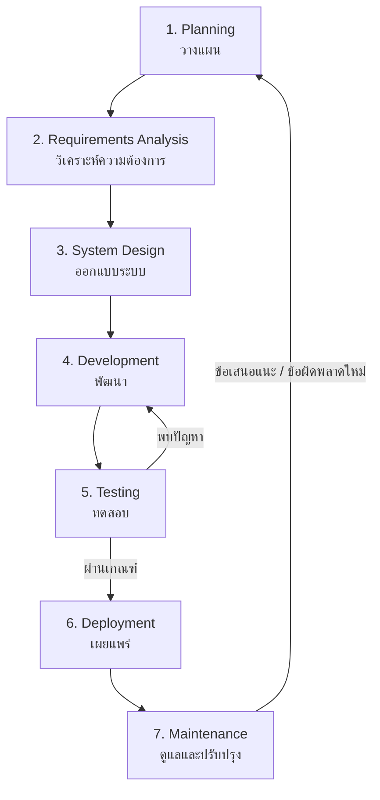

# SDLC ของ GeoWrisX AD — คู่มือคิดและพัฒนาซอฟต์แวร์ทีละขั้น

เอกสารนี้อธิบายวิธีคิดแบบ **SDLC (Software Development Life Cycle)** โดยใช้โครงการ GeoWrisX AD เป็นตัวอย่าง เพื่อให้คนอ่านเข้าใจทั้งว่าแต่ละขั้นทำอะไร ทำไปเพื่ออะไร ต้องตัดสินใจอะไร และใช้หลักฐานแบบไหนตรวจสอบความคืบหน้า

> **แนวคิดหลัก:** อย่าเริ่มจาก “อยากเขียนโค้ดอะไร” ทันที ให้เริ่มจาก “ปัญหาคืออะไร ใครเจอปัญหา เราต้องการผลลัพธ์อะไร และจะพิสูจน์ได้อย่างไรว่าระบบทำได้จริง”

## ภาพรวมวงจร SDLC

SDLC ไม่จำเป็นต้องทำเป็นเส้นตรงครั้งเดียว เมื่อทดสอบแล้วพบว่าความต้องการไม่ครบ อาจย้อนกลับไปออกแบบหรือพัฒนาใหม่ได้ นี่คือการปรับปรุงจากหลักฐาน ไม่ใช่ความล้มเหลวของกระบวนการ

---

## ขั้นที่ 1 — Planning: วางแผน

**เป้าหมาย:** ทำให้เข้าใจว่ากำลังแก้ปัญหาอะไร และกำหนดขอบเขตที่ทำได้จริง ก่อนใช้เวลาเขียนโปรแกรม

### วิธีคิด
- ปัญหาที่ต้องการแก้คืออะไร และมีใครได้รับผลกระทบ?
- เหตุใดวิธีเดิมจึงอาจยังไม่เพียงพอ?
- อะไรคือเป้าหมายหลัก อะไรอยู่นอกขอบเขต?
- มีข้อจำกัดด้านเวลา งบประมาณ อุปกรณ์ ความเป็นส่วนตัว หรือความปลอดภัยอะไรบ้าง?
- ความสำเร็จจะวัดจากอะไร ไม่ใช่แค่ “หน้าเว็บเปิดได้” ใช่หรือไม่?

### ตัวอย่างใน GeoWrisX AD
ปัญหาที่ศึกษาเกี่ยวกับการช่วยผู้ดูแลในการดูแลผู้ป่วยโรคสมองเสื่อม

### ผลลัพธ์ที่ควรมี
- คำอธิบายปัญหาและผู้ใช้เป้าหมาย  นั่นก็คือ ปัญหาการจัดการยา และ การกินยาผิดพลาด ของผู้ป่วยโรคสมองเสื่อม ผู้ใช้เป้าหมายคือผู้ดูแล ที่ต้องดูแลผู้ป่วยโรคสมองเสื่อม
- เป้าหมายและขอบเขตของรุ่นแรก สามารถแก้ไขปัญหาการจัดการยา และ การกินยาผิดพลาด ของผู้ป่วยโรคสมองเสื่อม และลดภาระของผู้ดูแลได้
- ข้อจำกัด ความเสี่ยง และเกณฑ์วัดความสำเร็จ 

### พร้อมไปขั้นถัดไปเมื่อ
ทีมอธิบายได้ตรงกันว่า “กำลังสร้างอะไร เพื่อใคร ทำไมต้องสร้าง และอะไรยังไม่รวมอยู่ในรุ่นนี้”

---

## ขั้นที่ 2 — Requirements Analysis: วิเคราะห์ความต้องการ

**เป้าหมาย:** เปลี่ยนปัญหาที่อธิบายกว้าง ๆ ให้เป็นความสามารถของระบบที่ชัดเจนและตรวจสอบได้

### วิธีคิด
แยกความต้องการเป็น 2 กลุ่ม

1. **Functional requirements — ระบบต้องทำอะไร** เช่น สมัครสมาชิก เข้าสู่ระบบ เพิ่มผู้ป่วย แก้ไขข้อมูล แสดงการแจ้งเตือน และแสดงคำขออนุมัติ
2. **Non-functional requirements — ระบบต้องมีคุณภาพอย่างไร** เช่น จำกัดสิทธิ์การเข้าถึง ปกป้องข้อมูลส่วนบุคคล ตอบสนองได้เหมาะสม จัดการข้อผิดพลาด และไม่เปิดเผยกุญแจลับในเบราว์เซอร์

จากนั้นกำหนดวิธีทดสอบความต้องการแต่ละข้อ เช่น “ผู้ดูแล A ต้องไม่สามารถอ่านหรือแก้ไขข้อมูลของผู้ดูแล B” เป็นข้อกำหนดที่ทดสอบได้ ไม่ใช่เพียงคำว่า “ระบบต้องปลอดภัย”

### ตัวอย่างใน GeoWrisX AD
- ผู้ดูแลสามารถแก้ไขชื่อและเบอร์โทรของตนได้
- ผู้ดูแลสามารถสร้าง แก้ไข เก็บเข้าคลัง และกู้คืนโปรไฟล์ผู้ป่วยได้
- อีเมลบัญชีแสดงเป็นข้อมูลอ่านอย่างเดียวบนหน้าจอโปรไฟล์นี้
- ข้อมูลฐานข้อมูลถูกจำกัดด้วย Supabase Auth และ Row Level Security (RLS)
- การจัดการดูแลผู้ป่ยโรคสมองเสื่อมได้สะดวก

### ผลลัพธ์ที่ควรมี
- รายการความต้องการที่จัดลำดับความสำคัญ
- User stories หรือกรณีการใช้งาน
- เกณฑ์ยอมรับ (acceptance criteria) สำหรับแต่ละฟังก์ชัน
- รายการความเสี่ยงและข้อกำหนดเรื่องข้อมูล/ความปลอดภัย

### พร้อมไปขั้นถัดไปเมื่อ
แต่ละฟังก์ชันมีคำอธิบายชัดเจนว่าใครใช้ ทำอะไร ควรเกิดผลลัพธ์ใด และจะทดสอบอย่างไร

---

## ขั้นที่ 3 — System Design: ออกแบบระบบ

**เป้าหมาย:** วางแผนว่าองค์ประกอบต่าง ๆ จะทำงานร่วมกันอย่างไร ก่อนลงมือแก้โค้ดจำนวนมาก

### วิธีคิด
- แบ่งระบบเป็นส่วนย่อยและกำหนดความรับผิดชอบของแต่ละส่วน
- ตัดสินใจว่าอะไรทำในเบราว์เซอร์ อะไรต้องทำในฝั่งเซิร์ฟเวอร์ และอะไรเก็บในฐานข้อมูล
- ออกแบบโครงสร้างตาราง ความสัมพันธ์ สิทธิ์ และขอบเขตข้อมูลของผู้ใช้
- กำหนดวิธีส่งข้อมูลระหว่างส่วนต่าง ๆ เช่น API, HTTPS และ token
- คิดถึงกรณีผิดปกติ เช่น ผู้ใช้ไม่ได้เข้าสู่ระบบ ข้อมูลหาย คำขอหมดอายุ หรือบริการปลายทางไม่ตอบสนอง

### ตัวอย่างใน GeoWrisX AD
- **React + Vite:** หน้าจอเว็บของผู้ดูแล
- **Supabase Auth:** จัดการบัญชีผู้ใช้และ session
- **Supabase PostgreSQL + RLS:** เก็บข้อมูลและจำกัดแถวที่ผู้ใช้เข้าถึงได้
- **Cloudflare Pages Functions:** API ฝั่งเซิร์ฟเวอร์ที่ตรวจ token ก่อนอ่านหรือเปลี่ยนข้อมูล
- **GitHub Actions:** ตรวจการ build และ syntax อัตโนมัติ
- **Gateway และอุปกรณ์จริง:** เป็นส่วนที่วางแผนเชื่อมต่อ ไม่ใช่ส่วนที่ยืนยันว่าทำงานครบแล้ว

### ผลลัพธ์ที่ควรมี
- แผนภาพสถาปัตยกรรมระบบ
- โครงสร้างฐานข้อมูลและนโยบายสิทธิ์
- รายการ API และรูปแบบข้อมูลที่รับ/ส่ง
- แผนจัดการข้อผิดพลาดและข้อมูลลับ

### พร้อมไปขั้นถัดไปเมื่อ
ทีมตอบได้ว่าแต่ละส่วนรับผิดชอบอะไร ข้อมูลวิ่งผ่านจุดใด และมีมาตรการป้องกันข้อมูลในแต่ละจุดอย่างไร

---

## ขั้นที่ 4 — Development: พัฒนา

**เป้าหมาย:** นำข้อกำหนดและแบบออกแบบมาเปลี่ยนเป็นโค้ด โดยแบ่งงานให้เล็กพอที่จะตรวจสอบได้

### วิธีคิด
1. เลือกงานขนาดเล็กที่มีเป้าหมายชัดเจน
2. แก้โค้ดเฉพาะส่วนที่เกี่ยวข้อง และไม่เก็บความลับไว้ใน repository
3. ตรวจรูปแบบโค้ดและความเข้ากันได้กับส่วนอื่น
4. บันทึกการเปลี่ยนแปลงด้วย Git commit ที่อธิบายว่าทำอะไร
5. อย่าถือว่าการเขียนโค้ดเสร็จแปลว่าคุณสมบัตินั้นผ่านการทดสอบแล้ว

### ตัวอย่างใน GeoWrisX AD
การพัฒนาฟอร์มโปรไฟล์ผู้ดูแลควรครอบคลุมทั้งหน้าจอ การเรียก API การตรวจข้อมูล และการบันทึกในฐานข้อมูล ไม่ใช่แค่เพิ่มกล่องกรอกข้อมูลใน React ส่วนการเพิ่มฟิลด์ในฐานข้อมูลควรมี migration ที่ชัดเจนและทดสอบก่อนพึ่งพาในโค้ด

### ผลลัพธ์ที่ควรมี
- โค้ดและการเปลี่ยนแปลงใน GitHub
- Migration หรือการตั้งค่าที่เกี่ยวข้อง
- คำอธิบายวิธีใช้งาน/ตั้งค่าที่อัปเดตตามจริง
- Commit ที่ตรวจสอบย้อนหลังได้

### พร้อมไปขั้นถัดไปเมื่อ
โค้ด build ได้ ไม่มี syntax error ที่ตรวจพบ และพร้อมเข้าสู่การทดสอบพฤติกรรมจริง โดยยังไม่สรุปว่าระบบถูกต้องจากการ build อย่างเดียว

---

## ขั้นที่ 5 — Testing: ทดสอบ

**เป้าหมาย:** เก็บหลักฐานว่าระบบทำตามข้อกำหนด และค้นหาความผิดพลาดก่อนเผยแพร่

### วิธีคิด
เริ่มจากถามว่า “อะไรอาจผิดพลาดได้บ้าง?” แล้วออกแบบกรณีทดสอบทั้งกรณีปกติและกรณีผิดปกติ

- **Unit / syntax checks:** ตรวจหน่วยย่อยหรือไวยากรณ์โค้ด
- **Integration testing:** ตรวจว่าหน้าเว็บ API และฐานข้อมูลทำงานร่วมกันได้
- **Functional testing:** ทดสอบฟังก์ชันตามเกณฑ์ยอมรับ
- **Security testing:** ตรวจการเข้าสู่ระบบ การแยกข้อมูลระหว่างบัญชี สิทธิ์ RLS และการจัดการข้อมูลลับ
- **End-to-end testing:** ทดสอบตั้งแต่ต้นจนจบ รวมถึงฮาร์ดแวร์จริงเมื่อเชื่อมต่อแล้ว

บันทึกทั้งผลที่คาดหวัง ผลที่เกิดจริง และหลักฐาน เช่น log ภาพหน้าจอ หรือผลจาก test runner หากไม่ผ่าน ให้ระบุข้อผิดพลาด แก้ไข แล้วทดสอบซ้ำ

### ตัวอย่างใน GeoWrisX AD
- ผู้ใช้ที่ยังไม่เข้าสู่ระบบเรียก API ป้องกันไว้แล้วต้องไม่ได้ข้อมูล
- บัญชีหนึ่งต้องไม่อ่านหรือแก้ไขโปรไฟล์ผู้ป่วยที่เป็นของอีกบัญชี
- ฟอร์มต้องปฏิเสธข้อมูลผิดรูปแบบ
- คำขออนุมัติที่หมดอายุหรือไม่มีหลักฐานที่อุปกรณ์เชื่อถือได้ต้องไม่ถูกถือว่าปลอดภัย
- เมื่อเชื่อมต่ออุปกรณ์จริง ต้องตรวจ event และสถานะกล่องยาตั้งแต่ต้นจนจบ

### ผลลัพธ์ที่ควรมี
- Test cases และผลผ่าน/ไม่ผ่าน
- บันทึก bug และการแก้ไข
- หลักฐานทดสอบที่ไม่เปิดเผยข้อมูลส่วนบุคคล
- รายการข้อจำกัดและการทดสอบที่ยังขาด

### พร้อมไปขั้นถัดไปเมื่อ
ผ่านเกณฑ์สำคัญที่กำหนดไว้ และความเสี่ยงที่ยังเหลือได้รับการบันทึกอย่างโปร่งใส ไม่ใช่เพียงเพราะหน้าเว็บเปิดได้

---

## ขั้นที่ 6 — Deployment: เผยแพร่

**เป้าหมาย:** นำเวอร์ชันที่ผ่านเกณฑ์ทดสอบไปยังสภาพแวดล้อมที่ผู้ใช้เข้าถึงได้ โดยไม่ทำให้ข้อมูลหรือระบบเสียหาย

### วิธีคิด
- แยกสภาพแวดล้อมพัฒนาออกจาก production
- ตรวจ environment variables, URL, authentication redirects และสิทธิ์ฐานข้อมูล
- ตรวจ build logs และ deploy logs
- ยืนยันว่า URL ที่เผยแพร่กำลังให้บริการ commit/เวอร์ชันที่ต้องการ
- เตรียมวิธีย้อนกลับหรือแก้ปัญหาเมื่อ deploy ไม่สำเร็จ

### ตัวอย่างใน GeoWrisX AD
เว็บนี้อยู่ในโฟลเดอร์ `geowrisx-web/` ของ repository จึงต้องตั้งค่า Root directory ให้ถูกต้องบน Cloudflare Pages โค้ดที่ push ขึ้น GitHub ไม่ได้หมายความว่าจะถูกเผยแพร่เป็น production โดยอัตโนมัติทุกครั้ง โดยเฉพาะเมื่อแพลตฟอร์มหยุด deploy หรือมีข้อจำกัดด้านโควตา

### ผลลัพธ์ที่ควรมี
- URL และเวอร์ชันที่เผยแพร่
- ผล build/deploy logs
- รายการ environment variables ที่ตั้งค่าแล้วโดยไม่เผยค่าลับ
- เช็กลิสต์ smoke test หลังเผยแพร่

### พร้อมไปขั้นถัดไปเมื่อ
ตรวจหน้าเว็บจริงแล้วว่าเป็นเวอร์ชันที่ตั้งใจปล่อย ฟังก์ชันสำคัญใช้งานได้ และไม่มีการเปิดเผยค่าลับหรือข้อมูลจริงโดยไม่ตั้งใจ

---

## ขั้นที่ 7 — Maintenance: ดูแลและปรับปรุง

**เป้าหมาย:** รักษาความน่าเชื่อถือของระบบหลังเผยแพร่ และปรับปรุงจากปัญหาที่พบจริง

### วิธีคิด
- ติดตาม error logs และปัญหาที่ผู้ใช้รายงาน
- อัปเดต dependencies และแก้ช่องโหว่
- สำรองและทดสอบการกู้คืนฐานข้อมูลตามแผน
- ทบทวนสิทธิ์เข้าถึงและการใช้ข้อมูลส่วนบุคคล
- แยกข้อเสนอแนะออกเป็นงานใหม่และจัดลำดับความสำคัญ
- เมื่อเพิ่มความสามารถใหม่ ให้วนกลับไปเริ่มจากการวิเคราะห์ความต้องการและออกแบบอีกครั้ง

### ตัวอย่างใน GeoWrisX AD
หลังจากฟังก์ชันเว็บเสถียรขึ้น งานต่อไปอาจเป็นการทดสอบ RLS กับหลายบัญชี การสำรองข้อมูล การทำบันทึกเหตุการณ์ และการพัฒนา gateway ที่เชื่อถือได้สำหรับ GPS/BLE ทั้งนี้การเชื่อมต่ออุปกรณ์จริงต้องมีการทดสอบความปลอดภัยและกลไกสำรอง ไม่ควรให้ต้นแบบนี้ใช้ตัดสินใจเรื่องยาหรือแทนการดูแลผู้ป่วยจริง

### ผลลัพธ์ที่ควรมี
- บันทึกเหตุขัดข้องและการแก้ไข
- แผนสำรอง/กู้คืนที่มีการทดสอบ
- รายการงานปรับปรุงและประวัติเวอร์ชัน
- หลักฐานการทดสอบซ้ำหลังเปลี่ยนแปลง

---

## สถานะ SDLC ของ GeoWrisX AD

สถานะต่อไปนี้เป็นภาพรวมจากโค้ดและการทดสอบที่บันทึกไว้ใน repository ไม่ใช่การรับรองว่าทุกส่วนพร้อมใช้งานจริง

| ขั้น | สถานะจากหลักฐานที่มี | ความหมาย |
|---|---|---|
| Planning | มีกรอบปัญหาและขอบเขตโครงการ | ระบุเป้าหมายและข้อจำกัดของต้นแบบแล้ว |
| Requirements Analysis | ฟังก์ชันหลักถูกระบุในเอกสารและโค้ด | ควรต่อยอดเป็น acceptance criteria และ test cases ที่ครบถ้วน |
| System Design | มีสถาปัตยกรรมเว็บ API และฐานข้อมูล | ส่วน gateway/อุปกรณ์จริงยังเป็นงานเชื่อมต่อในอนาคต |
| Development | มีโค้ดเว็บ, API และ migration ใน GitHub | มีฟังก์ชันจัดการบัญชีผู้ดูแลและโปรไฟล์ผู้ป่วยในโค้ด |
| Testing | GitHub Actions ตรวจ build และ syntax ได้ | ยังไม่เท่ากับการทดสอบ integration, security หรือ hardware แบบครบวงจร |
| Deployment | เว็บเผยแพร่ผ่าน Cloudflare Pages | การเผยแพร่โค้ดล่าสุดต้องตรวจสถานะ deploy ของแพลตฟอร์มแยกจากสถานะ GitHub |
| Maintenance | มีงานปรับปรุงและทดสอบต่อเนื่อง | ยังต้องเติมหลักฐานเรื่อง backup/restore, monitoring และ hardware validation |

### หลักฐานที่ควรสะสมในแต่ละรอบ
- [ ] ปัญหาหรือความต้องการที่กำลังแก้
- [ ] ขอบเขตและเกณฑ์ยอมรับ
- [ ] โค้ด/commit ที่เกี่ยวข้อง
- [ ] ผลทดสอบที่เกิดขึ้นจริง
- [ ] ข้อผิดพลาดและวิธีแก้
- [ ] เวอร์ชันที่เผยแพร่และข้อจำกัดที่ยังเหลือ

## วิธีใช้ SDLC กับงานถัดไปหนึ่งงาน

ตัวอย่าง: “เพิ่มการแก้ไขโปรไฟล์ผู้ดูแล”

1. **Planning:** ทำไมต้องแก้โปรไฟล์ และใครจะใช้?
2. **Requirements:** ระบุช่องที่แก้ได้ ช่องที่อ่านอย่างเดียว และรูปแบบข้อมูลที่ยอมรับ
3. **Design:** ตัดสินใจว่าจะส่งข้อมูลผ่าน API ใด ตารางใด และใช้นโยบาย RLS แบบไหน
4. **Development:** ทำ UI, API, validation และ database migration ที่จำเป็น
5. **Testing:** ทดสอบข้อมูลถูก/ผิด ผู้ใช้ไม่ได้ login และการเข้าถึงข้ามบัญชี
6. **Deployment:** ตรวจค่าตั้งค่าและปล่อยเฉพาะเมื่อผ่านเกณฑ์ พร้อมตรวจเวอร์ชันบนเว็บจริง
7. **Maintenance:** ตรวจ error logs รับข้อเสนอแนะ แก้ bug และอัปเดตเอกสาร

ทำแบบนี้กับงานทุกชิ้นจะช่วยให้เราไม่กระโดดไปเขียนโค้ดก่อนรู้ปัญหา และไม่กล่าวอ้างว่าระบบสมบูรณ์ก่อนมีหลักฐานยืนยัน

## คำศัพท์สำคัญ
- **Requirement:** สิ่งที่ผู้ใช้หรือระบบต้องการ
- **Acceptance criteria:** เงื่อนไขที่บอกได้ว่าฟังก์ชันนั้นยอมรับได้หรือยัง
- **Migration:** คำสั่งเปลี่ยนโครงสร้างฐานข้อมูลอย่างมีบันทึก
- **RLS:** กฎที่จำกัดว่าแต่ละบัญชีอ่านหรือแก้ไขแถวข้อมูลใดได้
- **CI/build check:** การตรวจโค้ดอัตโนมัติ ไม่ใช่หลักฐานว่าทุก workflow ทำงานถูกต้อง
- **Deployment:** การนำเวอร์ชันหนึ่งไปเผยแพร่บนระบบจริง
- **End-to-end test:** การทดสอบกระบวนการตั้งแต่ต้นทางถึงปลายทาง

---

*หมายเหตุ: GeoWrisX AD เป็นโครงงานต้นแบบเพื่อการศึกษา ใช้ข้อมูลจำลองในการสาธิต และไม่ควรใช้แทนการดูแลทางการแพทย์หรือระบบความปลอดภัยที่ผ่านการตรวจสอบแล้ว.*
